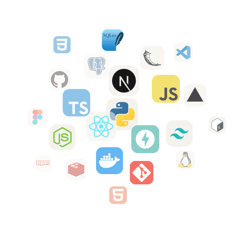
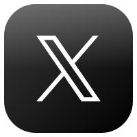
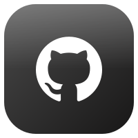

<!-- Header Banner -->

<!-- Animated Typing Effect -->

 

<!--Night Owl image-->

  

<!--Header Name-->
#  ɪ'ᴍ ᴀʏᴇsʜᴀ Ramzan!
*AI Engineer & Full-Stack Developer*
 

<!--Start Intro-->

I am an AI Engineer and Full-Stack Developer with a huge love for Python, Agentic AI, FastAPI, React.js, Next.js, PostgreSQL, REST APIs and WhatsApp Automation.

-  Student of life-BSCS student from Lahore, Pakistan :)
-  I'm currently learning multi-agent systems; I believe every day is a learning opportunity.
-  I build AI agents, chatbots, voice assistants and WhatsApp bots that get real work done.
-  I ship full-stack web apps from first idea all the way to production.
-  Love turning ideas into products people actually use.
-  Visit my [Portfolio](https://ayesha-ramzan.vercel.app) for more details about me.
<!--End Intro-->

<!--Profile Count Badge-->

  

---

<!--Languages and Tools Section-->       
<h2 align="center">Tᴇᴄʜ sᴛᴀᴄᴋ & Lᴀᴛᴇsᴛ ʙʟᴏɢs</h2> 
<picture>
  <source media="(prefers-color-scheme: dark)" srcset="./Skills_Animation_Dark.gif">
  <source media="(prefers-color-scheme: light)" srcset="./Skills_Animation_White.gif">
  
</picture>
 

<h3 align="left">Current Learning</h3>
<ul align="left">
  <li>Building multi-agent AI systems with tool use, memory and planning.</li>
  <li>Exploring LLM evaluation — testing prompts and measuring agent quality.</li>
  <li>Improving my skills in cloud deployment with Docker and CI/CD.</li>
</ul>

<h3 align="left">Recent Builds</h3>
<ul align="left">
  <li><a href="https://ayesha-ramzan.vercel.app">🔥Portfolio: multi-page, animated, 100 accessibility score 🎨</a></li>
  <li><a href="https://github.com/Ayesha-Ramzan/Jarvis-AI-COO">🔥JARVIS AI COO: multi-tenant FastAPI backend with 66 tests 🤖</a></li>
  <li><a href="https://github.com/Ayesha-Ramzan/Restaurant-WA-Order-Bot">Restaurant WhatsApp Order Bot: menu, orders &amp; payments 🍽️</a></li>
</ul>
 
 
 
 

<!--Trophies Section-->
<h2 align="center">🏆 Gɪᴛʜᴜʙ Tʀᴏᴘʜɪᴇs 🏆</h2>

  <a href="https://github.com/Ayesha-Ramzan">
    <picture>
      <source media="(prefers-color-scheme: dark)" srcset="https://github-profile-trophy-ruddy.vercel.app/?username=Ayesha-Ramzan&no-bg=true&row=2&column=6&margin-w=20&margin-h=20&theme=monokai">
      <source media="(prefers-color-scheme: light)" srcset="https://github-profile-trophy-ruddy.vercel.app/?username=Ayesha-Ramzan&no-bg=true&row=2&column=6&margin-w=20&margin-h=20">
      
    </picture>
  </a>

  

 

<!--Github stats Table-->
<h2 align="center">📊 Gɪᴛʜᴜʙ Sᴛᴀᴛs 📊</h2>

<table width="100%">
  <tr>
    <td width="50%">
      <h3 align="center"><strong>Gɪᴛʜᴜʙ Sᴛᴀᴛs</strong></h3>
      

        
      

    </td>
    <td width="50%">
      <h3 align="center"><strong>Sᴛʀᴇᴀᴋ Sᴛᴀᴛs</strong></h3>
      

        
      

    </td>
  </tr>
  <tr>
    <td width="50%">
      <h3 align="center"><strong>Lᴀᴛᴇsᴛ Pʀᴏᴊᴇᴄᴛ</strong></h3>
      

        
      

    </td>
    <td width="50%">
      <h3 align="center"><strong>Tᴏᴘ Cᴏɴᴛʀɪʙᴜᴛɪᴏɴs</strong></h3>
      

        
      

    </td>
  </tr>
</table>
 

<!--Contribution Graph-->
<h2 align="center">📈 Cᴏɴᴛʀɪʙᴜᴛɪᴏɴ Gʀᴀᴘʜ 📈</h2>

    

---

<!--Dynamic Quote card updates everyday at 12 AM-->
<h2 align="center">🌟 Tʜᴏᴜɢʜᴛ ᴏғ ᴛʜᴇ Dᴀʏ 🌟</h2>

<!--STARTS_HERE_QUOTE_CARD-->

    

<!--ENDS_HERE_QUOTE_CARD-->

<!--Contact Section-->

<h2 align="center"> Cᴏɴɴᴇᴄᴛ Wɪᴛʜ Mᴇ 🤝 </h2>

 

<!--Portfolio button (in place of Buy me a coffee)-->

<!--Footer-->

  

