

I'm <b>Ayesha Ramzan</b> — an AI Engineer &amp; Full-Stack Developer who turns ideas into products people actually use. My toolkit ranges from <b>React, Next.js and TypeScript</b> on the frontend to <b>Python, FastAPI and PostgreSQL</b> under the hood. Passionate about <b>agentic AI, LLM apps and WhatsApp automation</b>, I build assistants that don't just answer — they get real work done.

  
  
  
  

 

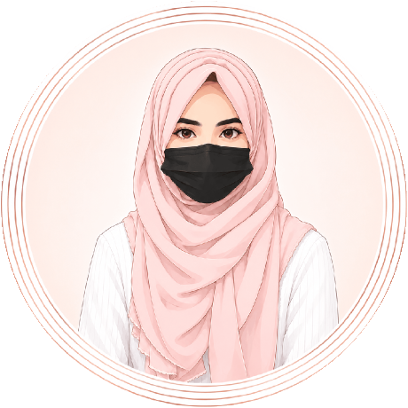

<h2>ɪ'ᴍ ᴀʏᴇsʜᴀ!</h2>

<i>AI Engineer · Full-Stack Developer · BSCS Student</i>

I design <b>agentic AI systems</b> — assistants that understand a request, decide the next step, call tools and finish the job — and wrap them in fast, clean full-stack products.

- Currently building **GTOS**, a workforce platform, at **Gobind Trades**
- Building AI agents, chatbots and **WhatsApp automations** for real businesses
- Shipping web apps with **React, Next.js, FastAPI and PostgreSQL**
- Learning something new every day — currently multi-agent systems
- Visit my [**portfolio**](https://ayesha-ramzan.vercel.app) for the full story

 

 

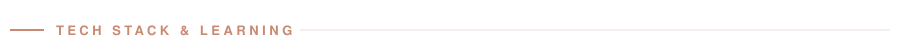

 


  

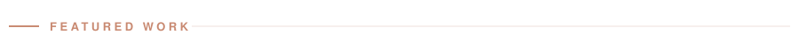

 

<a href="https://gtos-employee.srv1763060.hstgr.cloud/welcome">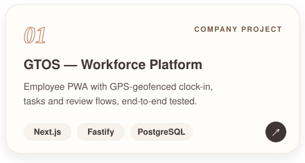</a>&nbsp;<a href="https://github.com/Ayesha-Ramzan/Restaurant-WA-Order-Bot">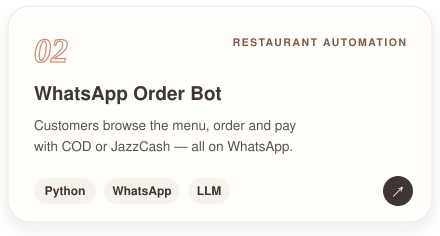</a>
<a href="https://github.com/Ayesha-Ramzan/Jarvis-AI-COO">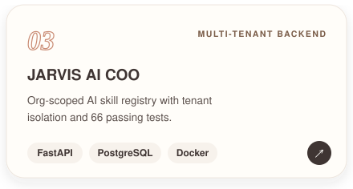</a>&nbsp;<a href="https://github.com/Ayesha-Ramzan/J.A.R.V.I.S.-AI-Voice-Assistant">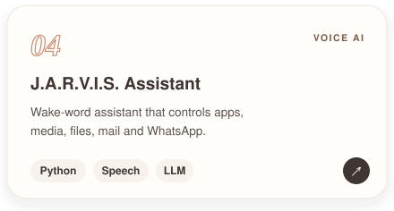</a>
<a href="https://mehfil-restaurant-lahore.vercel.app">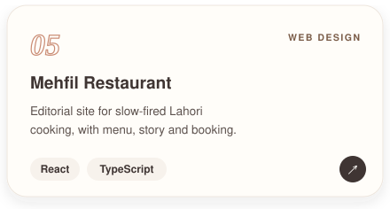</a>&nbsp;<a href="https://myproject-habit-tracker.vercel.app">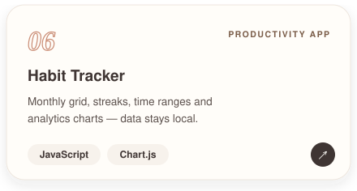</a>

  

   

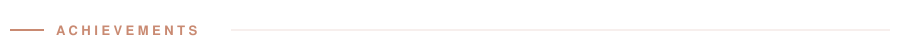


  

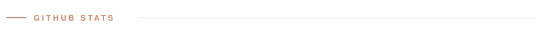

&nbsp;
<a href="https://github.com/Ayesha-Ramzan?tab=repositories&amp;sort=updated"></a>&nbsp;

  

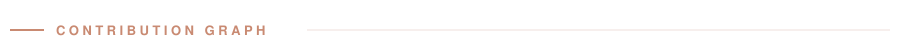


 

<picture>
  <source media="(prefers-color-scheme: dark)" srcset="https://raw.githubusercontent.com/Ayesha-Ramzan/Ayesha-Ramzan/output/pacman-contribution-graph-dark.svg">
  <source media="(prefers-color-scheme: light)" srcset="https://raw.githubusercontent.com/Ayesha-Ramzan/Ayesha-Ramzan/output/pacman-contribution-graph.svg">
  
</picture>

  


  

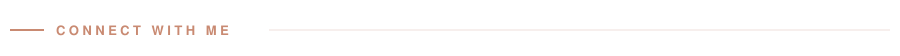

&nbsp;&nbsp;&nbsp;&nbsp;<a href="https://x.com/ayesha5044">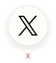</a>&nbsp;&nbsp;<a href="https://ayesha-ramzan.vercel.app"></a>

  

